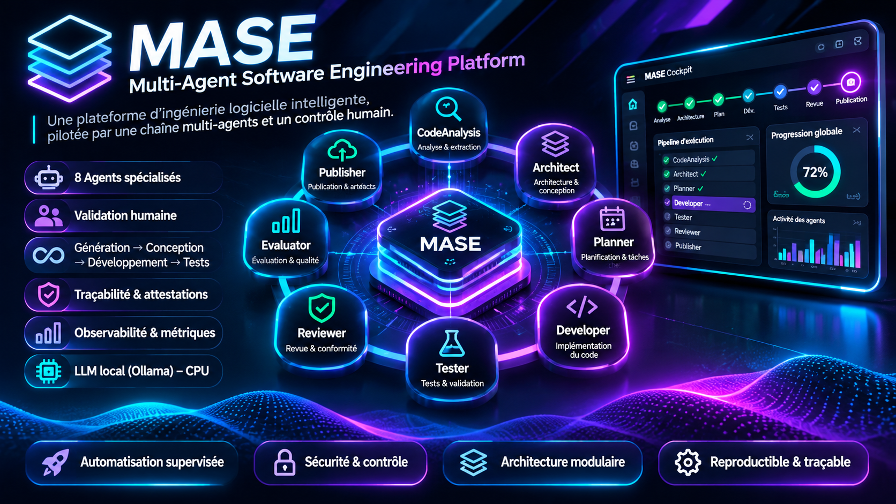
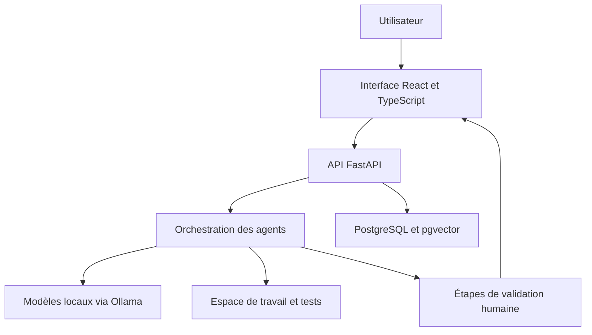

# MASE

### Multi-Agent Software Engineering Platform

**Une plateforme locale de génie logiciel assisté par IA, avec supervision humaine.**

MASE explore la coordination d’agents spécialisés pour transformer une demande de modification logicielle en exigences, architecture, plan et proposition de code évaluée. Le projet associe des modèles de langage locaux à des contrôles logiciels et à des décisions humaines explicites.

Projet personnel développé par **Aymen Bouhlel**, élève-ingénieur en informatique à l’ENSICAEN.

## Le problème étudié

Une modification logicielle mobilise plusieurs activités liées entre elles — comprendre la demande, analyser le dépôt, concevoir, développer, tester et revoir les résultats. MASE vise à organiser ces activités dans un parcours traçable, où l’utilisateur peut consulter les propositions et contrôler les étapes de validation.

## Architecture générale

Ce schéma présente les grandes responsabilités du système. Les parcours réellement qualifiés sont précisés plus bas.

## Axes de développement

- Analyse des exigences et du code existant.
- Conception d’architecture et planification des modifications.
- Coordination d’agents de développement, de test, de sécurité, de revue et d’évaluation.
- Validation humaine des propositions aux étapes prévues par le workflow.
- Persistance des tâches, historique et traçabilité des décisions.
- Consultation des rapports, de l’activité et des métriques disponibles.
- Gestion des échecs et reprise des exécutions.

## Technologies

| Domaine | Technologies |
|---|---|
| Backend | Python, FastAPI |
| Interface | React, TypeScript, Vite |
| Persistance | PostgreSQL, pgvector |
| Modèles locaux | Ollama |
| Environnement | Docker, Linux |
| Vérification | Tests backend, frontend et SQL, contrôle de types |

## État du projet au 8 novembre 2026

**Prototype en développement — jalon R05-A PARTIAL.**

Le pipeline complet actuel reste à qualifier de bout en bout avec les modèles locaux et les validations humaines.

Les résultats ci-dessous sont issus du bilan local du développeur. Les preuves détaillées restent dans l’environnement privé du projet.

| Vérification | Dernier résultat rapporté |
|---|---|
| Sélection backend élargie | 251 tests réussis sur 252 |
| Sélection R05-A, incluse dans la sélection backend | 233 tests réussis |
| Tests SQL sur base jetable | 45 tests réussis |
| Tests frontend | 89 tests réussis |
| Contrôle TypeScript et build frontend | Réussis |
| Lancement sur une base explicitement migrée | Vérifié |
| Consultation API et conservation de l’historique après redémarrage API | Vérifiées sur données synthétiques |
| Parcours navigateur | Partiellement vérifié, une assertion en échec |
| Conception Architect réelle après R05-A | À qualifier |

Ces résultats couvrent les périmètres testés. Ils ne constituent pas une validation du pipeline complet.

## Prochaines étapes

1. Vérifier le schéma de base avant l’annonce de disponibilité du lanceur. Un défaut a été reproduit sur base vierge.
2. Diagnostiquer l’assertion en échec du parcours navigateur.
3. Vérifier la configuration et l’utilisation de l’identité humaine locale.
4. Qualifier un petit scénario Architect avec Ollama.
5. Vérifier un scénario complet jusqu’au résultat final et à sa validation.

## Présentation publique et accès au code

Cette vitrine rassemble la présentation du projet. Le code applicatif est conservé dans un dépôt privé.

**[Demander l’accès au code](https://github.com/aymenbouhlel575/mase-showcase/issues/new/choose)**

Pour une évaluation technique, un recrutement ou une collaboration, cliquez sur « Demander l’accès au code » dans la liste des formulaires, puis renseignez votre identifiant GitHub et le motif de votre demande. Aymen Bouhlel examine chaque demande et, s’il l’accepte, envoie une invitation au dépôt privé.

Les demandes sont publiques : ne communiquez aucune donnée confidentielle. L’accès reste soumis à une validation manuelle.

## Contact

**Aymen Bouhlel**

[Profil LinkedIn](https://www.linkedin.com/in/aymen-bouhlel-8038bb345/) · [Profil GitHub](https://github.com/aymenbouhlel575)
